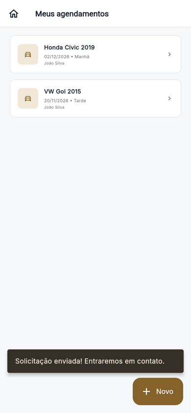
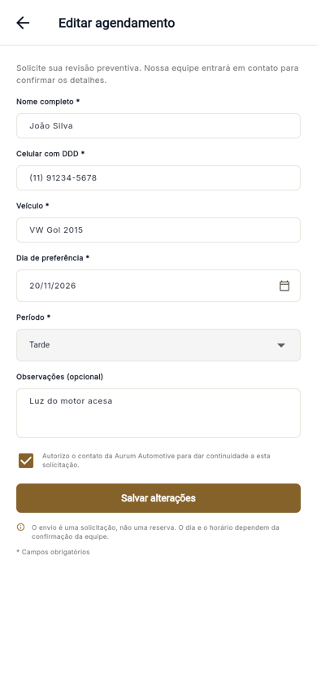

# Aurum Automotive

Aplicativo Flutter para **solicitar e gerenciar agendamentos de revisão preventiva** de veículos, consumindo a API Laravel desenvolvida na disciplina de Laravel.

| | |
|---|---|
| **Aluno** | _[seu nome completo aqui]_ |
| **Back-end** | **Opção A — API Laravel** (consumida com o pacote `http`, autenticação Sanctum) |
| **Entidade do CRUD** | Agendamento (`/agendamentos`) |

## Descrição

A Aurum Automotive é uma oficina que oferece um pacote de revisão preventiva. No app o cliente:

- conhece o pacote na página inicial;
- cria uma conta ou entra com e-mail e senha;
- **solicita** um agendamento (veículo, celular, dia e período de preferência);
- **lista**, **vê os detalhes**, **edita** e **exclui** os próprios agendamentos.

Todos os dados de usuário e agendamentos vêm da API. Nada fica fixo no código.

## Telas e rotas

A navegação usa `go_router` com rotas nomeadas definidas em `lib/core/routes/` e é feita sempre com `context.goNamed(...)`.

| Tela | Nome da rota | Caminho | Login? | Função |
|---|---|---|---|---|
| Início | `home` | `/` | não | Apresentação do pacote e atalhos para agendar |
| Login | `sign-in` | `/login` | não | Entrar com e-mail e senha |
| Cadastro | `sign-up` | `/cadastro` | não | Criar conta |
| Meus agendamentos | `appointments` | `/agendamentos` | sim | **Listar** (GET) |
| Novo agendamento | `appointment-new` | `/agendamentos/novo` | sim | **Criar** (POST) |
| Detalhes | `appointment-details` | `/agendamentos/:id` | sim | **Detalhar** (GET) e **excluir** (DELETE) |
| Editar agendamento | `appointment-edit` | `/agendamentos/:id/editar` | sim | **Editar** (PUT) |
| Minha conta | `account` | `/conta` | sim | Perfil (GET `/user`) e logout |

As rotas privadas são protegidas pelo `redirect` do `go_router`: quem não está logado é levado para `/login`.

## Arquitetura

O projeto segue a mesma estrutura do repositório de referência (Guia Financeiro):

```
lib/
├── main.dart          # inicializações: datas em pt_BR e sessão salva
├── app.dart           # widget raiz: tema + rotas + idioma
├── core/
│   ├── constants/     # app_strings.dart (textos da interface), home_content.dart
│   ├── routes/        # app_routes.dart (nomes/caminhos), app_router.dart (go_router)
│   ├── theme/         # app_colors, app_spacing (espaços/raios/tamanhos), app_text_styles, app_theme
│   └── utils/         # validators.dart, formatters.dart, phone_input_formatter.dart
├── models/            # app_user.dart, appointment.dart (fromJson/toJson)
├── services/          # api_client.dart, auth_service.dart, appointment_service.dart
├── screens/
│   ├── home/          # home_screen.dart + sections/ (blocos da página inicial)
│   ├── auth/          # sign_in_screen.dart, sign_up_screen.dart
│   ├── appointments/  # lista, formulário, detalhes e card da lista
│   └── account/       # account_screen.dart
└── widgets/           # componentes usados por mais de uma tela
```

### Regras de dependência

- **models/** não importa Flutter: `Appointment` e `AppUser` só descrevem dados e fazem a conversão de/para JSON.
- **services/** não importa widgets: devolve models (`Future<List<Appointment>>`, `Future<Appointment>`) e lança `ApiException` com a mensagem de erro pronta.
- **screens/** nunca chama `http`: sempre passa por `AppointmentService` ou `AuthService`.
- **core/** não importa `services/`: o router recebe o estado de login por parâmetro (`isSignedIn`, `authChanges`) em `app.dart`. Como no projeto de referência, `app_router.dart` importa as telas para montar as rotas.

### Como os dados fluem

```
Tela  ──chama──▶  AppointmentService  ──usa──▶  ApiClient  ──HTTP──▶  API Laravel
  ▲                    │                           │
  └──── models ◀───────┘◀──── JSON ────────────────┘
```

- **`ApiClient`** concentra o endereço da API, os cabeçalhos, o token Bearer, o tempo limite (15 s) e a tradução dos erros do Laravel (401, 404, 422 com `errors`).
- **`AuthService`** é um `ChangeNotifier`: faz login, cadastro e logout, salva o token com `shared_preferences` e avisa o router quando o login muda.
- **`AppointmentService`** faz o CRUD e incrementa o `ValueNotifier changes` a cada alteração. A lista e os detalhes escutam esse contador e recarregam sozinhos.

### Programação assíncrona e estados

- Lista, detalhes e conta usam `FutureBuilder` com três estados: **carregando** (`LoadingState`), **erro** (`ErrorState`, com botão "Tentar novamente") e **lista vazia** (`EmptyState`).
- Os formulários usam `async/await`, desabilitam o botão enquanto salvam e mostram o erro da API num `SnackBar`.

### Validação

Os formulários usam `Form` + `TextFormField`, com validadores centralizados em `core/utils/validators.dart`: obrigatório, nome e sobrenome, e-mail, senha (mínimo de 8), confirmação de senha, celular com DDD, data a partir de hoje, período e aceite de contato.

## API utilizada

| Ação | Método | Rota |
|---|---|---|
| Cadastro | POST | `/api/register` |
| Login | POST | `/api/login` → `{ "token": "..." }` |
| Usuário logado | GET | `/api/user` |
| Logout | POST | `/api/logout` |
| Listar agendamentos | GET | `/api/agendamentos` |
| Detalhar | GET | `/api/agendamentos/{id}` |
| Criar | POST | `/api/agendamentos` |
| Editar | PUT | `/api/agendamentos/{id}` |
| Excluir | DELETE | `/api/agendamentos/{id}` |

Corpo de um agendamento:

```json
{
  "nome": "João Silva",
  "celular": "11912345678",
  "veiculo": "VW Gol 2015",
  "data_preferencia": "20/11/2026",
  "periodo": "Tarde",
  "observacoes": "Luz do motor acesa",
  "aceite_contato": true
}
```

O app aceita respostas com ou sem o envelope `{"data": ...}` dos API Resources, e lê a data em `dd/mm/aaaa`, `aaaa-mm-dd` ou ISO 8601.

## Como rodar

Pré-requisitos: Flutter 3.44 ou superior e a API Laravel rodando (`php artisan serve`, porta 8000).

1. Instale as dependências:

   ```bash
   flutter pub get
   ```

2. Rode o app. Por padrão ele usa `http://localhost:8000/api` (Chrome ou Windows):

   ```bash
   flutter run -d chrome
   ```

   No **emulador Android**, `localhost` é o próprio emulador, então informe o endereço do computador:

   ```bash
   flutter run --dart-define=API_URL=http://10.0.2.2:8000/api
   ```

3. Verificações de qualidade:

   ```bash
   flutter analyze
   ```

   ```bash
   dart format .
   ```

   ```bash
   flutter test
   ```

## Prints das telas

| Início | Login | Lista | Formulário | Detalhes |
|---|---|---|---|---|
|  |  |  |  |  |

| Editar | Excluir | Lista vazia | Erro | Conta |
|---|---|---|---|---|
|  |  |  |  |  |
