# Aurum Automotive — App

Aplicativo Flutter para **agendar serviços de oficina**: o cliente cadastra seus veículos e solicita, reagenda, cancela e acompanha agendamentos. Todos os dados vêm da API Laravel [mecanica-api](https://github.com/schmidtgabriel30-sys/mecanica-api).

| | |
|---|---|
| **Aluno** | Gabriel Schmidt |
| **Back-end** | **Opção A — API Laravel** (consumida com o pacote `http`, autenticação Sanctum) |
| **Entidades com CRUD** | Agendamento (`/agendamentos`) e Veículo (`/veiculos`) |

## Descrição

No app o cliente:

- conhece a oficina e o pacote de revisão na página inicial;
- cria uma conta ou entra com e-mail e senha;
- **cadastra, edita e exclui** os seus veículos;
- **solicita** um agendamento, escolhendo veículo e serviço (catálogo vindo da API), dia e período;
- **lista** e **vê os detalhes** dos agendamentos, com a situação (pendente, confirmado, concluído, cancelado), o valor e o mecânico;
- **reagenda** enquanto o agendamento está pendente, **cancela** ou **exclui**.

O **administrador da oficina** entra com o usuário fixo **`AdminA`** e a senha **`AdminA`** e cai num **painel próprio**, com visual escuro e o selo ADMIN. No painel ele:

- vê os agendamentos de **todos os clientes**, com nome e e-mail de quem solicitou, veículo, serviço e data;
- acompanha contadores por situação e filtra a lista;
- **aceita** ou **recusa** cada solicitação e escolhe o mecânico responsável;
- conduz o atendimento: **iniciar atendimento** e depois **concluir**.

Fluxo da situação: **pendente → confirmado → em atendimento → concluído** (pendente e confirmado também podem ser cancelados).

As regras de negócio são da API: período lotado, veículo já agendado no mesmo período, veículo com agendamento em aberto etc. Quando a API recusa uma operação, a mensagem dela aparece no app.

## Telas e rotas

A navegação usa `go_router` com rotas nomeadas definidas em `lib/core/routes/` e é feita sempre com `context.goNamed(...)`.

| Tela | Nome da rota | Caminho | Login? | Função |
|---|---|---|---|---|
| Início | `home` | `/` | não | Apresentação e atalhos para agendar |
| Login | `sign-in` | `/login` | não | Entrar |
| Cadastro | `sign-up` | `/cadastro` | não | Criar conta |
| Meus agendamentos | `appointments` | `/agendamentos` | sim | Listar (GET) |
| Novo agendamento | `appointment-new` | `/agendamentos/novo` | sim | Criar (POST) |
| Detalhes | `appointment-details` | `/agendamentos/:id` | sim | Ver (GET), cancelar (PUT) e excluir (DELETE) |
| Reagendar | `appointment-edit` | `/agendamentos/:id/editar` | sim | Editar data, período e observações (PUT) |
| Meus veículos | `vehicles` | `/veiculos` | sim | Listar (GET) |
| Cadastrar veículo | `vehicle-new` | `/veiculos/novo` | sim | Criar (POST) |
| Editar veículo | `vehicle-edit` | `/veiculos/:id/editar` | sim | Editar (PUT) e excluir (DELETE) |
| Minha conta | `account` | `/conta` | sim | Perfil (GET `/user`) e logout |
| Painel da oficina | `admin` | `/admin` | admin | Todos os agendamentos, contadores e filtro |
| Atendimento | `admin-appointment` | `/admin/agendamentos/:id` | admin | Aceitar, recusar, escolher mecânico, iniciar e concluir (PUT) |

O `redirect` do `go_router` protege as rotas:
- quem não está logado vai para `/login`;
- o **admin** fica sempre no painel (`/admin`);
- o **cliente** não consegue abrir o painel.

## Arquitetura

O projeto segue a mesma estrutura do repositório de referência (Guia Financeiro):

```
lib/
├── main.dart          # inicializações: datas em pt_BR e sessão salva
├── app.dart           # widget raiz: tema + rotas + idioma
├── core/
│   ├── constants/     # app_strings.dart (textos da interface), home_content.dart
│   ├── routes/        # app_routes.dart (nomes/caminhos), app_router.dart (go_router)
│   ├── theme/         # app_colors, app_spacing (espaços/raios/tamanhos), app_text_styles, app_theme
│   └── utils/         # validators.dart, formatters.dart
├── models/            # app_user, vehicle, service_item, appointment (fromJson/toJson)
├── services/          # api_client, json_parser, auth, vehicle, service_item, appointment
├── screens/
│   ├── home/          # home_screen.dart + sections/ (blocos da página inicial)
│   ├── auth/          # login e cadastro
│   ├── appointments/  # lista, formulário (novo/reagendar) e detalhes
│   ├── vehicles/      # lista e formulário (novo/editar/excluir)
│   ├── admin/         # painel da oficina e tela de atendimento
│   └── account/       # minha conta
└── widgets/           # componentes usados por mais de uma tela
```

### Regras de dependência

- **models/** não importa Flutter: só descreve dados e converte de/para JSON.
- **services/** não importa widgets: devolve models e lança `ApiException` com a mensagem pronta.
- **screens/** nunca chama `http`: sempre passa por um service.
- **core/** não importa `services/`: o router recebe o estado de login por parâmetro em `app.dart`. Como no projeto de referência, `app_router.dart` importa as telas para montar as rotas.

### Como os dados fluem

```
Tela ──chama──▶ AppointmentService / VehicleService ──usa──▶ ApiClient ──HTTP──▶ API Laravel
  ▲                          │                                   │
  └──────── models ◀─────────┘◀────────────── JSON ──────────────┘
```

- **`ApiClient`** concentra o endereço da API, os cabeçalhos, o token Bearer, o tempo limite e a tradução dos erros do Laravel (401, 403, 404, 409 e 422).
- **`JsonParser`** é reaproveitado por todos os services para transformar JSON inválido em erro amigável.
- **`AuthService`** é um `ChangeNotifier`: faz login (por e-mail ou usuário), cadastro e logout, salva o token e o perfil com `shared_preferences` e informa se o usuário é admin (`isAdmin`).
- **`VehicleService`** e **`AppointmentService`** fazem o CRUD e avisam as telas (`ValueNotifier changes`) para recarregar depois de cada alteração.

### Componentes reutilizáveis

- **`ListScreenBody`** trata os três estados das listas (carregando, erro e lista vazia) e é usado pelas listas de agendamentos e de veículos.
- **`ListTileCard`** é o cartão dessas listas.
- **`StatusBadge`** é a etiqueta de situação, usada na lista e nos detalhes.
- **`AdminScaffold`** é a estrutura visual do painel (barra escura com o selo ADMIN), usada nas duas telas do admin.
- **`InfoRow`** é a linha "ícone + rótulo + valor" dos detalhes do cliente e do atendimento do admin.
- **`ConfirmDialog`**, **`PrimaryButton`**, **`DangerButton`**, **`AppTextField`** e **`PasswordField`** são usados nos formulários.

### Validação

Os formulários usam `Form` + `TextFormField`, com validadores centralizados em `core/utils/validators.dart`, que espelham as regras da API:
- conta: e-mail, senha (mínimo de 8), confirmação, nome e sobrenome;
- veículo: placa no padrão antigo ou Mercosul, ano entre 1950 e o próximo ano;
- agendamento: data a partir de hoje, veículo, serviço e período obrigatórios.

## API consumida

| Ação | Método | Rota | Corpo enviado |
|---|---|---|---|
| Cadastro / login | POST | `/api/register`, `/api/login` | `name, email, password, password_confirmation` / `login` (e-mail ou usuário), `password` |
| Usuário logado / logout | GET / POST | `/api/user`, `/api/logout` | — |
| Catálogo de serviços | GET | `/api/servicos` | — |
| Veículos | GET, POST, PUT, DELETE | `/api/veiculos[/{id}]` | `marca, modelo, placa, ano` |
| Listar / detalhar agendamentos | GET | `/api/agendamentos[/{id}]` | — |
| Criar agendamento | POST | `/api/agendamentos` | `veiculo_id, servico_id, data_agendamento (aaaa-mm-dd), periodo (manha/tarde/noite), observacoes` |
| Reagendar | PUT | `/api/agendamentos/{id}` | `data_agendamento, periodo, observacoes` |
| Cancelar | PUT | `/api/agendamentos/{id}` | `status: "cancelado"` |
| Admin: listar todos | GET | `/api/agendamentos?per_page=50` | — |
| Admin: mudar situação | PUT | `/api/agendamentos/{id}` | `status` (`confirmado`, `em_atendimento`, `concluido`, `cancelado`), `mecanico_id` |
| Admin: mecânicos | GET | `/api/mecanicos` | — |
| Excluir agendamento | DELETE | `/api/agendamentos/{id}` | — |

## Como rodar

1. Suba a API ([mecanica-api](https://github.com/schmidtgabriel30-sys/mecanica-api)) seguindo o README dela: `php artisan migrate --seed` e depois `php artisan serve`. O seeder cria:

   | Perfil | Login | Senha |
   |---|---|---|
   | Admin (fixo) | `AdminA` | `AdminA` |
   | Cliente | `cliente@aurum.com` | `12345678` |
   | Cliente | `maria@aurum.com` | `12345678` |

2. Instale as dependências do app:

   ```bash
   flutter pub get
   ```

3. Rode o app. Por padrão ele usa `http://localhost:8000/api` (Chrome ou Windows):

   ```bash
   flutter run -d chrome
   ```

   No **emulador Android**, `localhost` é o próprio emulador, então informe o endereço do computador:

   ```bash
   flutter run --dart-define=API_URL=http://10.0.2.2:8000/api
   ```

4. Verificações de qualidade:

   ```bash
   flutter analyze
   ```

   ```bash
   dart format .
   ```

   ```bash
   flutter test
   ```

## Prints das telas

| Início | Login | Agendamentos | Novo agendamento |
|---|---|---|---|
|  | 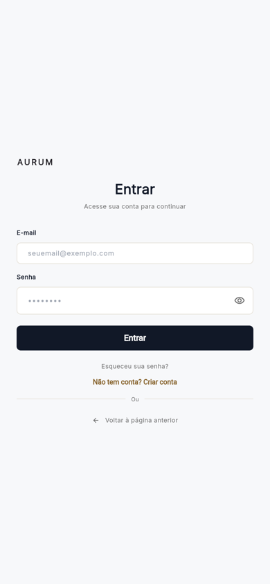 | 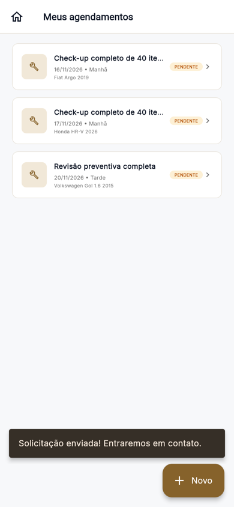 | 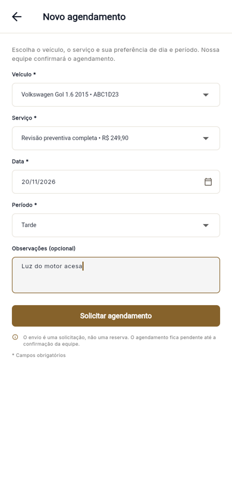 |

| Detalhes | Reagendar | Cancelado | Meus veículos |
|---|---|---|---|
| 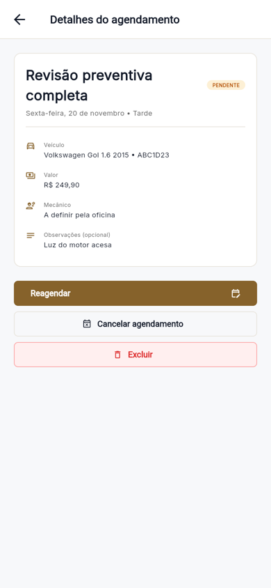 | 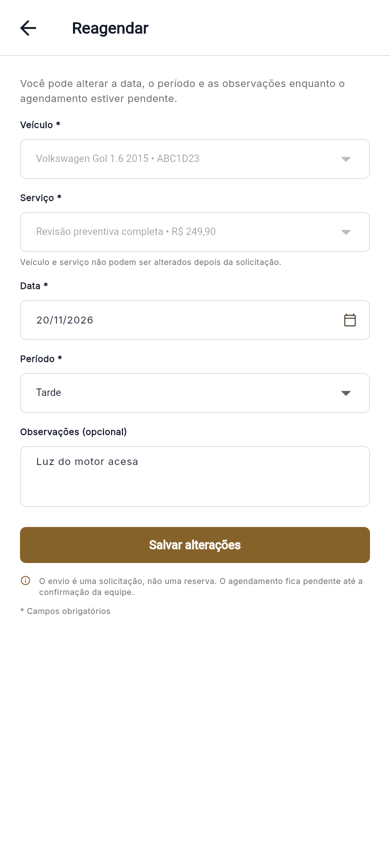 | 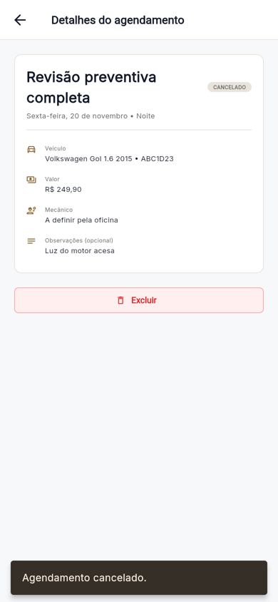 | 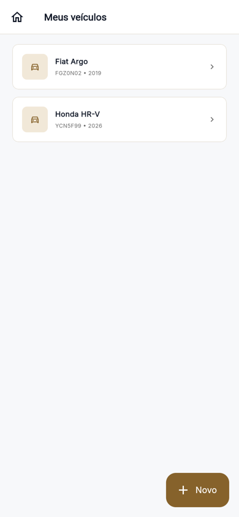 |

| Cadastrar veículo | Regra da API (409) | Lista vazia | Erro de conexão |
|---|---|---|---|
| 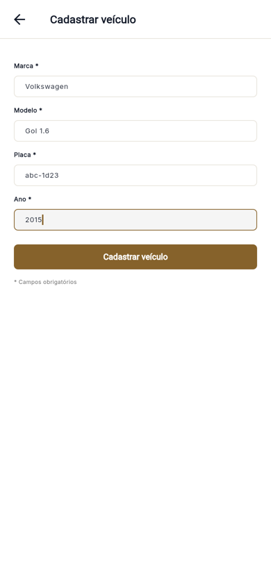 | 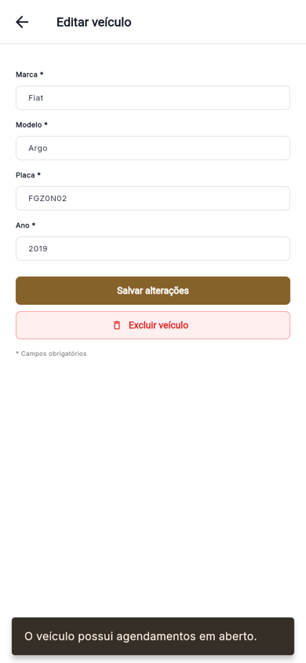 |  |  |

**Painel do administrador**

| Login do admin | Painel | Atendimento | Concluído | Cliente vê a situação |
|---|---|---|---|---|
| 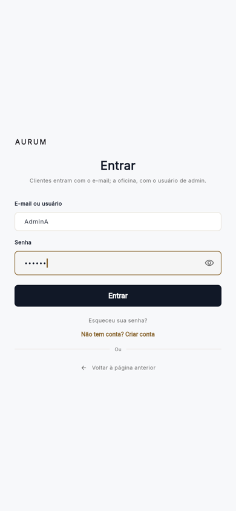 | 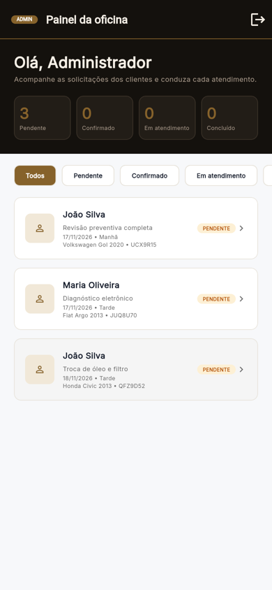 | 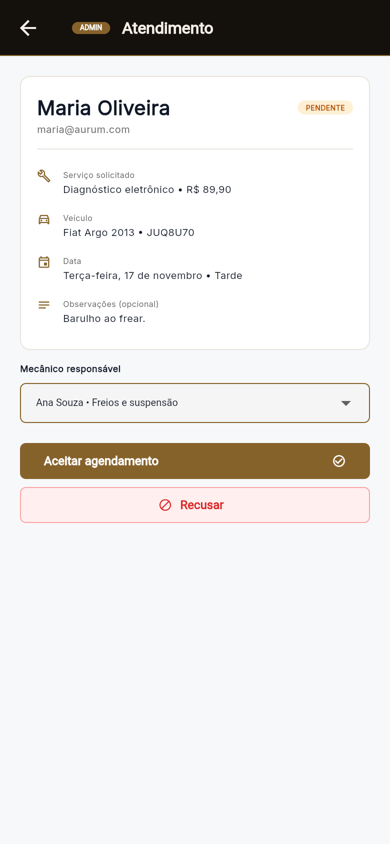 | 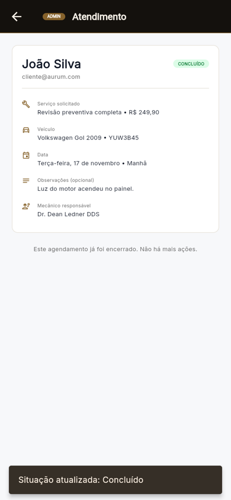 |  |
